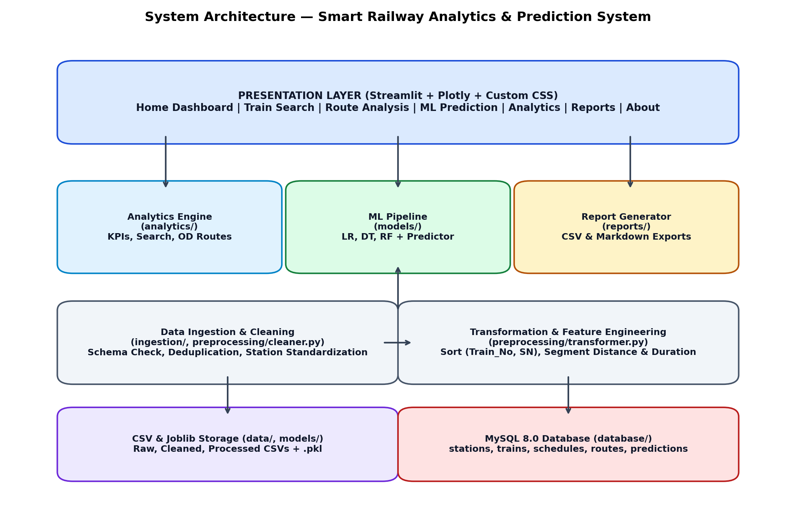
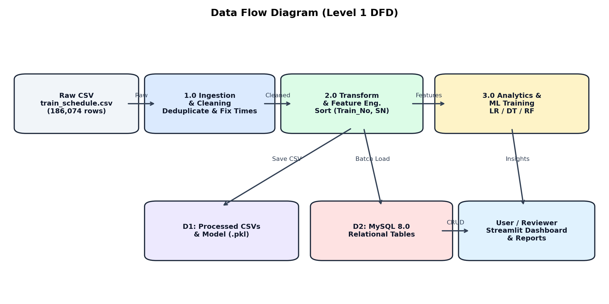
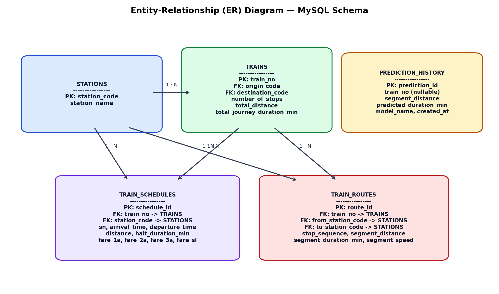

# Smart Railway Analytics and Train Journey Prediction System

**MCA Final-Year Major Project** — An end-to-end **Data Engineering, Machine Learning, MySQL, and Streamlit Web Analytics** platform built on Indian railway timetable data (`186,074` schedule records across `11,113` trains and `8,147` stations).

---

## 1. Abstract

Railway networks generate large volumes of structured timetable, route, station, and fare data. Raw schedule datasets often suffer from formatting inconsistencies, station naming mismatches, and missing derived route metrics. The **Smart Railway Analytics and Train Journey Prediction System** transforms a raw railway schedule dataset into an end-to-end analytical and predictive web application. It implements a modular Python ETL pipeline (`ingestion/`, `preprocessing/`), normalized relational storage in **MySQL 8.0** (`database/`), analytical search and KPI services (`analytics/`), multi-model regression training and inference (`models/`), automated CSV/Markdown reporting (`reports/`), and an interactive 7-page **Streamlit + Plotly** web dashboard (`dashboard/`).

---

## 2. Introduction

Traditional railway schedule files are flat CSV tables where each row represents a single stop along a train's journey. Answering practical questions—such as finding direct trains between two cities, identifying the busiest railway junctions, comparing longest and shortest routes, or estimating scheduled segment travel time—requires structured transformation, relational modeling, and predictive analytics. This project upgrades an initial single-script prototype (`main.py`) into a production-structured, testable 3-tier web application suitable for MCA major project demonstration.

---

## 3. Problem Statement

The original repository stored all logic in a single 410-line monolithic script (`main.py`) with several critical limitations:
1. **Sorting Bug:** Schedules were sorted by `["Train_No", "Route_Number"]` where `Route_Number` was constant (`1`), instead of stop sequence `SN`.
2. **Datetime Serialization Issue:** Time columns were saved as `1900-01-01 HH:MM:SS` strings in processed CSVs.
3. **Station Name Inconsistencies:** Three station codes (`SVDK`, `UMB`, `LDH`) mapped to multiple station name variants.
4. **Weak ML Features & Low Accuracy:** The original `DecisionTreeRegressor` used `["Train_No", "Route_Number", "Distance"]` (cumulative distance rather than segment distance), achieving only **R² = 0.4253** and **MAE = 14.30 minutes**.
5. **No Database, Web UI, or Tests:** No MySQL persistence, no interactive web dashboard, no input validation, and no automated unit tests.

---

## 4. Objectives

- Build a clean, modular **3-tier web architecture** separating Frontend, Backend/ML, and MySQL Database layers.
- Fix all ETL bugs while preserving the original raw dataset (`data/raw/train_schedule.csv`).
- Normalize and store railway entities in **MySQL 8.0** with primary/foreign keys and parameterized CRUD operations.
- Engineer meaningful route-segment features and compare **Linear Regression**, **Decision Tree**, and **Random Forest** models using **MAE**, **RMSE**, and **R²**.
- Deliver an interactive 7-page **Streamlit + Plotly** dashboard with Custom CSS, Train/Station/OD search, route analysis, ML duration prediction, and downloadable reports.
- Provide automated `pytest` unit tests and complete MCA documentation.

---

## 5. Existing System vs. Proposed System

| Aspect | Existing System (Original Repo) | Proposed System (Enhanced MCA Project) |
|---|---|---|
| **Code Structure** | Single 410-line `main.py` | Modular packages (`ingestion/`, `preprocessing/`, `database/`, `analytics/`, `models/`, `reports/`, `dashboard/`, `utils/`, `tests/`) |
| **Sorting & Duration** | Sorted by constant `Route_Number` | Sorted by `(Train_No, SN)`; computes segment distance, halt duration, and full-route duration |
| **Database** | None (CSV files only + 90M-cell crosstab) | Normalized **MySQL 8.0** schema (`stations`, `trains`, `train_schedules`, `train_routes`, `prediction_history`) with `.env` config |
| **Machine Learning** | Single Decision Tree (`R² = 0.4253`, `MAE = 14.30`) | 3-model comparison; best **Random Forest** (`R² = 0.8837`, `MAE = 6.42`, `RMSE = 14.09`) |
| **Visualization & UI** | Blocking `matplotlib` windows | Interactive 7-page **Streamlit + Plotly** web app with Custom CSS |
| **Quality & Security** | No tests, no logging, hardcoded paths | `pytest` unit tests, centralized logging, input validation, environment-based credentials |

---

## 6. Hardware and Software Requirements

### Hardware Requirements
- **Processor:** 64-bit Intel Core i3 / AMD Ryzen 3 or higher
- **RAM:** Minimum 8 GB (recommended for processing 186k rows and Random Forest training)
- **Storage:** Minimum 2 GB free disk space

### Software Requirements
- **Operating System:** Windows 10/11 (64-bit), Linux, or macOS
- **Python:** Python 3.14 (used here because Windows Smart App Control on this machine blocked unsigned Python 3.13 SciPy `.pyd` DLLs; see Environment Notes below)
- **Database:** MySQL Server 8.0 (`mysql-connector-python`)
- **Libraries:** `pandas`, `numpy`, `scikit-learn`, `joblib`, `streamlit`, `plotly`, `python-dotenv`, `matplotlib`, `pytest`

---

## 7. System Architecture



The system is organized into three layers:
1. **Presentation Layer (`dashboard/`):** Streamlit multi-page UI with Plotly interactive charts and Custom CSS.
2. **Application & ML Layer (`ingestion/`, `preprocessing/`, `analytics/`, `models/`, `reports/`, `utils/`):** Handles schema validation, ETL cleaning/feature engineering, search/KPI analytics, ML training/inference, and report exports.
3. **Data Layer (`database/`, `data/`):** MySQL 8.0 relational database for structured querying and CRUD operations, paired with CSV/Joblib pipeline artifacts.

---

## 8. Data Flow Diagram (DFD)



1. **Process 1.0 (Ingestion & Cleaning):** Reads `data/raw/train_schedule.csv`, validates required columns, standardizes `HH:MM:SS` times and station names, removes duplicates -> outputs `data/cleaned/validated_train_schedule.csv`.
2. **Process 2.0 (Transformation & Feature Engineering):** Sorts by `(Train_No, SN)`, computes `Segment_Distance`, `Journey_Duration_Minutes`, `Halt_Duration_Minutes`, `Departure_Hour`, and train/station summaries -> outputs `data/processed/*.csv` and `data/aggregated/*.csv` + loads MySQL tables.
3. **Process 3.0 (Analytics & ML):** Trains/evaluates regression models -> saves `models/train_journey_duration_model.pkl` & `models/model_metrics.json`; serves interactive dashboard queries and downloadable reports.

---

## 9. ER Diagram & Database Design



### MySQL Schema Summary (`database/schema.sql`)
1. **`stations`** — `station_code` (PK), `station_name`
2. **`trains`** — `train_no` (PK), `origin_code` (FK), `destination_code` (FK), `origin_departure`, `destination_arrival`, `number_of_stops`, `total_distance`, `total_journey_duration_minutes`, `avg_speed_kmph`, `max_1a_fare`, `max_sl_fare`
3. **`train_schedules`** — `schedule_id` (PK), `train_no` (FK), `sn`, `station_code` (FK), `route_number`, `arrival_time`, `departure_time`, `distance`, `halt_duration_minutes`, `fare_1a`, `fare_2a`, `fare_3a`, `fare_sl`
4. **`train_routes`** — `route_id` (PK), `train_no` (FK), `from_station_code` (FK), `to_station_code` (FK), `stop_sequence`, `segment_distance`, `segment_duration_minutes`, `segment_speed_kmph`
5. **`prediction_history`** — `prediction_id` (PK), `train_no`, `segment_distance`, `total_train_distance`, `total_train_stops`, `stop_order_index`, `departure_hour`, `halt_duration_minutes`, `predicted_duration_minutes`, `model_name`, `created_at`

---

## 10. Module Descriptions

- **`utils/`** (`config.py`, `logger.py`, `validators.py`): Path management, `.env` credential loading, file+console logging, and input validation.
- **`ingestion/`** (`loader.py`): Reads raw CSV and checks required schema columns.
- **`preprocessing/`** (`cleaner.py`, `transformer.py`): Deduplicates, standardizes station names & `HH:MM:SS` times, sorts by `(Train_No, SN)`, and derives segment/route features.
- **`database/`** (`schema.sql`, `connection.py`, `loader.py`, `repository.py`): Parameterized MySQL connection, batch ETL loader, and full CRUD repository.
- **`analytics/`** (`kpis.py`, `search.py`, `route_analysis.py`): KPI metrics, train/station/Origin-Destination search, longest/shortest routes, and busiest station analytics.
- **`models/`** (`trainer.py`, `predictor.py`): Trains/compares regression models (`MAE`, `RMSE`, `R²`), saves the best `.pkl` bundle, and validates inference inputs.
- **`reports/`** (`generator.py`): Generates downloadable Markdown executive reports and filtered CSV exports.
- **`dashboard/`** (`app.py`, `styles.py`, `data_loader.py`, `pages/*.py`): 7-page Streamlit + Plotly web application.
- **`tests/`**: `pytest` suite covering ingestion, preprocessing, analytics, ML, and database repository logic.

---

## 11. Machine Learning Methodology

- **Problem Formulation:** Supervised regression predicting **scheduled leg duration (`Journey_Duration_Minutes`)** between consecutive stops.
- **Scope Honesty:** Because `train_schedule.csv` contains scheduled timetable data rather than historical actual arrival/departure logs, the model predicts **scheduled duration** (not live operational train delays).
- **Engineered Input Features:**
  1. `Segment_Distance` (km between current stop and next stop)
  2. `Total_Train_Distance` (overall train route distance)
  3. `Total_Train_Stops` (stop count proxy for express vs. passenger service)
  4. `Stop_Order_Index` (position along the route)
  5. `Departure_Hour` (0–23 scheduled departure hour)
  6. `Halt_Duration_Minutes` (halt time at current station)
- **Train / Test Split:** `80%` training (`139,727` samples) / `20%` testing (`34,932` samples), `random_state=42`.

### Results (Observed Evaluation Metrics)

| Model | MAE (Minutes) | RMSE (Minutes) | R² Score |
|---|---:|---:|---:|
| **Linear Regression** | 7.6238 | 15.4213 | 0.8607 |
| **Decision Tree Regressor** | 6.8989 | 14.9301 | 0.8694 |
| **Random Forest Regressor (Selected)** | **6.4224** | **14.0898** | **0.8837** |

Compared to the original prototype (`MAE = 14.30 min`, `R² = 0.4253`), feature engineering and proper `(Train_No, SN)` sorting improved **R² from 0.4253 to 0.8837** and cut **MAE by more than half**.

---

## 12. Project Folder Structure

```text
End-to-End-Train-Pipeline/
├── .env.example
├── .gitignore
├── main.py
├── requirements.txt
├── README.md
├── analytics/
├── dashboard/
│   ├── app.py
│   ├── data_loader.py
│   ├── styles.py
│   └── pages/
├── data/
│   ├── raw/
│   ├── cleaned/
│   ├── processed/
│   └── aggregated/
├── database/
├── diagrams/
├── ingestion/
├── models/
├── preprocessing/
├── reports/
├── tests/
└── utils/
```

---

## 13. Setup, Installation & Run Instructions

### Step 1: Activate Virtual Environment & Install Dependencies
*(Python 3.14 `.venv` is pre-configured to comply with Windows Smart App Control)*

```powershell
cd C:\Users\sutar\.gemini\antigravity\scratch\End-to-End-Train-Pipeline
.\.venv\Scripts\Activate.ps1
pip install -r requirements.txt
```

### Step 2: Configure MySQL Credentials (Required for Database Features)
1. Ensure **MySQL Server 8.0** is running on port `3306`.
2. Copy `.env.example` to `.env`:
   ```powershell
   copy .env.example .env
   ```
3. Edit `.env` and set your real `MYSQL_PASSWORD` (and `MYSQL_USER` / `MYSQL_DATABASE` if different).

### Step 3: Run ETL + MySQL Loader + ML Pipeline
- With MySQL configured:
  ```powershell
  python main.py
  ```
- Without MySQL (ETL + ML only):
  ```powershell
  python main.py --skip-db
  ```

### Step 4: Run Unit Tests
```powershell
pytest -v
```

### Step 5: Launch the Streamlit Web Application
```powershell
streamlit run dashboard/app.py
```

---

## 14. Testing

Automated tests in `tests/` verify:
- Schema validation and raw CSV ingestion (`test_ingestion.py`)
- Deduplication, `(Train_No, SN)` sorting fix, and midnight wrap-around duration calculation (`test_preprocessing.py`)
- KPI computation, train number search, station search, and Origin → Destination search (`test_analytics.py`)
- Model training, MAE/RMSE/R² reporting, `.pkl` persistence, and input validation (`test_models.py`)
- `.env` MySQL config loading and parameterized SQL CRUD queries (`test_database.py`)

---

## 15. Conclusion & Future Scope

### Conclusion
The upgraded **Smart Railway Analytics and Train Journey Prediction System** transforms a monolithic data script into a modular, well-tested MCA major project featuring automated ETL, MySQL relational persistence, accurate ML scheduled duration prediction (`R² = 0.8837`), and an interactive 7-page Streamlit dashboard.

### Future Scope
- Integrate live/historical delay feeds (e.g., NTES/IRCTC APIs) to enable real-time delay forecasting.
- Add shortest-path multi-hop transfer routing (Dijkstra/BFS graph search) across connecting trains.
- Containerize the application and MySQL database with Docker Compose for one-command cloud deployment.
